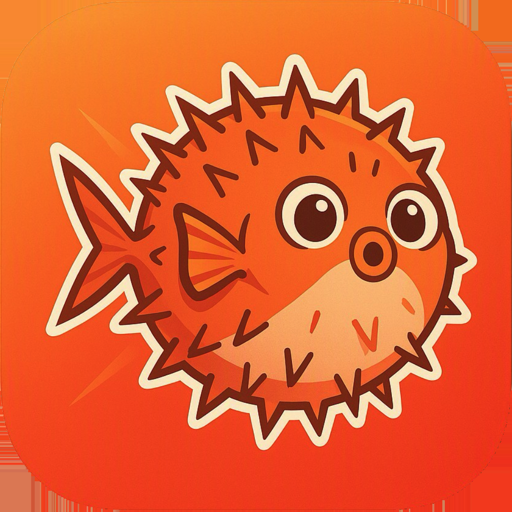
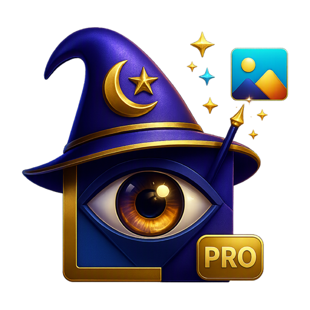

# macOS app releases

Welcome to the public iO repository — here you’ll find release downloads and Sparkle update feeds for macOS. Note: this is not a source-code repository. Source and publishing tools are maintained separately on Gitea.

## Zipio

Packs files and folders into ZIP archives that open with the built-in tools in macOS and Windows. Current version: **1.5.0 (build 13)**.

- macOS 26 or later
- Intel and Apple silicon
- Signed with Developer ID and notarised by Apple
- Update archives include Sparkle EdDSA signatures

[Download Zipio 1.5.0](https://github.com/iodigital-com/macOS-app-releases/releases/download/zipio-v1.5.0/Zipio-1.5.0.zip) · SHA-256 `5f16cd312ff21cfb89f1e98226ae6ed9b072ec196749f7eee96f2932f73b50c0`

Unzip and drag `Zipio.app` to Applications. Zipio then checks for updates once a day; you can also choose **Check for Updates…** in the Zipio menu. Installing always asks first. Zipio 1.3.1 and earlier cannot update themselves: install 1.5.0 once by hand.

## UpgradeKit Test

A minimal test app for validating Sparkle updates through the UpgradeKit package, version 0.2.1 build 6. It is not a general-purpose updater for other apps.

- macOS 12 or later
- Intel and Apple silicon
- Signed with Developer ID and notarised by Apple
- Update archives include Sparkle EdDSA signatures

[Download UpgradeKit Test 0.2.1](https://github.com/iodigital-com/macOS-app-releases/releases/download/upgradekit-test-v0.2.1/UpgradeKitTest-0.2.1.zip) · SHA-256 `f1fa3a6fe929215bd871d4d5f6ebed79642796a05dcaf55b7c0f21576e755157`

## Nutwork

Menu bar app that explains in plain language whether the network works and, if not, where the chain breaks: Wi-Fi, IP address, router, DNS, internet or VPN. Current version: **1.7.0 (build 22)**.

- macOS 26 or later
- English, Swedish, French, Dutch and Danish
- Signed with Developer ID and notarised by Apple
- Update archives include Sparkle EdDSA signatures

[Download Nutwork 1.7.0](https://github.com/iodigital-com/macOS-app-releases/releases/download/nutwork-v1.7.0/Nutwork-1.7.0.zip) · SHA-256 `edfe790906f9b11116839246e5d92058fc34e527ed1d7b169871d2dddbff960e`

Unzip and open `Nutwork.app`; it offers to move itself to Applications. Nutwork then checks for updates once a day; you can also choose **Check for Updates…** in the Nutwork menu. Installing always asks first. Nutwork 1.5.1 and earlier cannot update themselves: install a newer version once by hand.

## Aivis

AI tagging and descriptions for files in Elvis DAM, on this Mac with Apple Intelligence or with iO Bonzai. Current version: **1.2.4 (build 7)**.

- macOS 27 or later
- Apple silicon
- Swedish and English
- Signed with Developer ID and notarised by Apple
- Update archives include Sparkle EdDSA signatures

[Download Aivis 1.2.4](https://github.com/iodigital-com/macOS-app-releases/releases/download/aivis-v1.2.4/Aivis-1.2.4.zip) · SHA-256 `39bbdcfadb070fce4b3a393131445009163da79b48d241711642a87a6c82b49e`

Unzip and open `Aivis.app`; if it is not in Applications, it offers to move itself there. Aivis then checks for updates automatically; you can also choose **Check for Updates…** in the Aivis menu. Installing always asks first. Aivis 1.1.0 and earlier cannot update themselves: install the current version once by hand.

## Nuvis

Upload and download files and folders between Finder and Elvis DAM, with optional AI tagging. Current version: **1.2.4 (build 7)**.

- macOS 27 or later
- Apple silicon
- Swedish and English
- Signed with Developer ID and notarised by Apple
- Update archives include Sparkle EdDSA signatures

[Download Nuvis 1.2.4](https://github.com/iodigital-com/macOS-app-releases/releases/download/nuvis-v1.2.4/Nuvis-1.2.4.zip) · SHA-256 `2acf0ecbffe89ac2255f0477abc01f1843e264b3819f5ffca5f2a1f9379910c3`

Unzip and open `Nuvis.app`; if it is not in Applications, it offers to move itself there. Nuvis then checks for updates automatically; you can also choose **Check for Updates…** in the Nuvis menu. Installing always asks first. Nuvis 1.1.0 and earlier cannot update themselves: install the current version once by hand.

## Helpio

iO's IT help desk on the Mac: search iO's intranet in Confluence and see your Jira tickets in one window. Early preview, current version: **0.3.1 (build 6)**.

- macOS 27 or later
- Apple silicon
- Needs iO's office network or a VPN gateway that allows personal access tokens (NL, BE or BG)
- Signed with Developer ID and notarised by Apple
- Update archives include Sparkle EdDSA signatures

[Download Helpio 0.3.1](https://github.com/iodigital-com/macOS-app-releases/releases/download/helpio-v0.3.1/Helpio-0.3.1.zip) · SHA-256 `bc258edc6a5242e8c23cf4813f644adfa243a045290215f3872cac874994ca5a`

Ticket titles, descriptions and comments are translated on the Mac to your preferred language; original text remains available. Apple may ask to download language packs.

Unzip and open `Helpio.app`; if it is not in Applications, Helpio offers to move itself there. Add your own Confluence and Jira personal access tokens in Helpio's settings. Helpio then checks for updates once a day; you can also choose **Check for Updates…** in the Helpio menu. Installing always asks first.

## Nugu

SFTP and SCP client with two panes, local and remote. Drag files to and from Finder and follow every transfer in the queue. Nugu uses the macOS SSH tools, so your SSH settings and agents such as 1Password keep working. Current version: **1.0.0 (build 3)**.

- macOS 26 or later
- Signed with Developer ID and notarised by Apple
- Update archives include Sparkle EdDSA signatures

[Download Nugu 1.0.0](https://github.com/iodigital-com/macOS-app-releases/releases/download/nugu-v1.0.0/Nugu-1.0.0.zip) · SHA-256 `a2ab521f16384ce24cbb87cd7072e269d82e6d69eb6287bd01b178fe4f9cb872`

Unzip and open `Nugu.app`; it offers to move itself to Applications. Nugu then checks for updates once a day; you can also choose **Check for Updates…** in the Nugu menu. Installing always asks first, and never interrupts a running transfer.

## Numage

Converts images into AIIF text prompts with on-device Apple Intelligence and renders AIIF files back into images with Image Playground. Includes batch export, roundtrip and Quick Look previews. Current version: **1.3.0 (build 6)**.

- macOS 27 or later
- Apple silicon with Apple Intelligence enabled
- Swedish and English
- Signed with Developer ID and notarised by Apple
- Update archives include Sparkle EdDSA signatures

[Download Numage 1.3.0](https://github.com/iodigital-com/macOS-app-releases/releases/download/numage-v1.3.0/Numage-1.3.0.zip) · SHA-256 `fcba7adf363cea40a60eb8bd4c0a9e06f7e5817f5367dad3e246e8fe56cb357b`

Unzip and open `Numage.app`; if it is not in Applications, it offers to move itself there. The download also contains a README and four example AIIF files. Numage then checks for updates once a day; you can also choose **Check for Updates…** in the Numage menu. Installing always asks first. Numage 1.2.0 and earlier cannot update themselves: install the current version once by hand.

## Numage Pro

Converts images into AIIF text prompts and renders AIIF files back into images with iO Bonzai through iO BonzaiKit. All Bonzai processing stays in the EU. Includes batch export and roundtrip. Current version: **1.1.0 (build 2)**.

- macOS 27 or later
- Apple silicon
- An iO Bonzai API key
- Swedish and English
- Signed with Developer ID and notarised by Apple
- Update archives include Sparkle EdDSA signatures

[Download Numage Pro 1.1.0](https://github.com/iodigital-com/macOS-app-releases/releases/download/numage-pro-v1.1.0/Numage-Pro-1.1.0.zip) · SHA-256 `198f09197650f61093fb06deb7a099b2c299c43be4aa12cdda7dde37ffc6f7fe`

Unzip and open `Numage Pro.app`; if it is not in Applications, it offers to move itself there. Enter your iO Bonzai API key in Settings; it is stored in your login Keychain. Numage Pro then checks for updates once a day; you can also choose **Check for Updates…** in the Numage Pro menu. Installing always asks first. Numage Pro 1.0.0 cannot update itself: install the current version once by hand.

## All apps

For installed apps, use the app's update command — no GitHub account is required to download. Releases tagged `-test-` are update tests, not stable versions.

[Full releases](https://github.com/iodigital-com/macOS-app-releases/releases)
