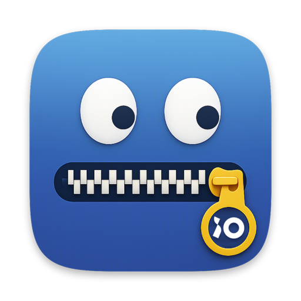
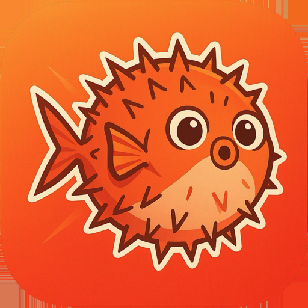
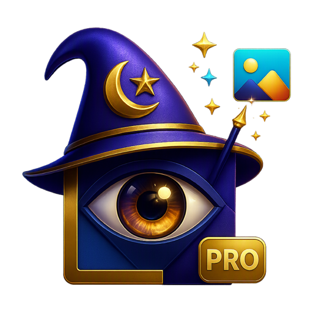
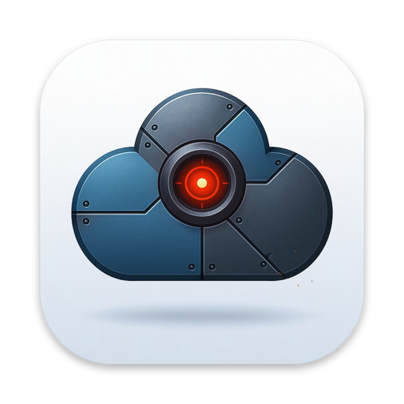
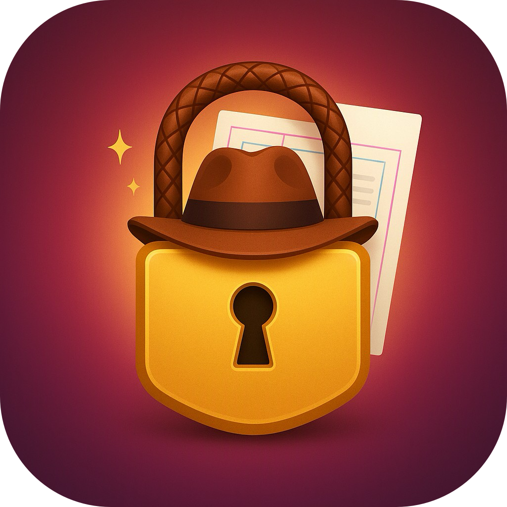
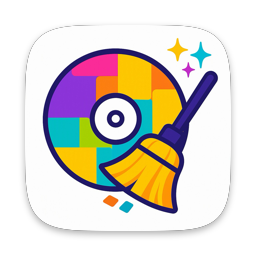
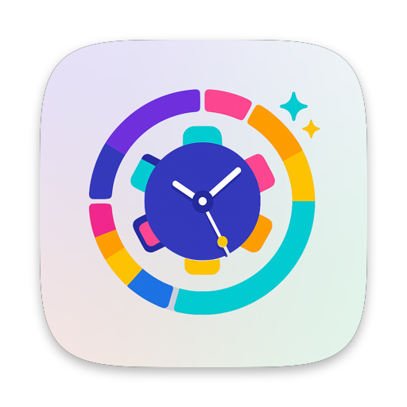

# macOS app releases

Welcome to the public iO repository — here you’ll find release downloads and Sparkle update feeds for macOS. Note: this is not a source-code repository. Source and publishing tools are maintained separately on Gitea.

## Zipio

Packs files and folders into ZIP archives that open with the built-in tools in macOS and Windows. Current version: **1.5.0 (build 13)**.

- macOS 26 or later
- Intel and Apple silicon
- Signed with Developer ID and notarised by Apple
- Update archives include Sparkle EdDSA signatures

[Download Zipio 1.5.0](https://github.com/iodigital-com/macOS-app-releases/releases/download/zipio-v1.5.0/Zipio-1.5.0.zip) · SHA-256 `5f16cd312ff21cfb89f1e98226ae6ed9b072ec196749f7eee96f2932f73b50c0`

Unzip and drag `Zipio.app` to Applications. Zipio then checks for updates once a day; you can also choose **Check for Updates…** in the Zipio menu. Installing always asks first. Zipio 1.3.1 and earlier cannot update themselves: install 1.5.0 once by hand.

## UpgradeKit Test

A minimal test app for validating Sparkle updates through the UpgradeKit package, version 0.3.1 build 8. It is not a general-purpose updater for other apps.

- macOS 12 or later
- Intel and Apple silicon
- Signed with Developer ID and notarised by Apple
- Update archives include Sparkle EdDSA signatures

[Download UpgradeKit Test 0.3.1](https://github.com/iodigital-com/macOS-app-releases/releases/download/upgradekit-test-v0.3.1/UpgradeKitTest-0.3.1.zip) · SHA-256 `52bb82a8bf2a4381b23b89c0956038adfbbd3cc1311cabaee3030f5155f011c6`

## Nutwork

Menu bar app that explains in plain language whether the network works and, if not, where the chain breaks: Wi-Fi, IP address, router, DNS, internet or VPN. Current version: **1.7.0 (build 22)**.

- macOS 26 or later
- English, Swedish, French, Dutch and Danish
- Signed with Developer ID and notarised by Apple
- Update archives include Sparkle EdDSA signatures

[Download Nutwork 1.7.0](https://github.com/iodigital-com/macOS-app-releases/releases/download/nutwork-v1.7.0/Nutwork-1.7.0.zip) · SHA-256 `edfe790906f9b11116839246e5d92058fc34e527ed1d7b169871d2dddbff960e`

Unzip and open `Nutwork.app`; it offers to move itself to Applications. Nutwork then checks for updates once a day; you can also choose **Check for Updates…** in the Nutwork menu. Installing always asks first. Nutwork 1.5.1 and earlier cannot update themselves: install a newer version once by hand.

## Aivis

AI tagging and descriptions for files in Elvis DAM, on this Mac with Apple Intelligence or with iO Bonzai. Current version: **1.2.4 (build 7)**.

- macOS 27 or later
- Apple silicon
- Swedish and English
- Signed with Developer ID and notarised by Apple
- Update archives include Sparkle EdDSA signatures

[Download Aivis 1.2.4](https://github.com/iodigital-com/macOS-app-releases/releases/download/aivis-v1.2.4/Aivis-1.2.4.zip) · SHA-256 `39bbdcfadb070fce4b3a393131445009163da79b48d241711642a87a6c82b49e`

Unzip and open `Aivis.app`; if it is not in Applications, it offers to move itself there. Aivis then checks for updates automatically; you can also choose **Check for Updates…** in the Aivis menu. Installing always asks first. Aivis 1.1.0 and earlier cannot update themselves: install the current version once by hand.

## Nuvis

Upload and download files and folders between Finder and Elvis DAM, with optional AI tagging. Current version: **1.2.4 (build 7)**.

- macOS 27 or later
- Apple silicon
- Swedish and English
- Signed with Developer ID and notarised by Apple
- Update archives include Sparkle EdDSA signatures

[Download Nuvis 1.2.4](https://github.com/iodigital-com/macOS-app-releases/releases/download/nuvis-v1.2.4/Nuvis-1.2.4.zip) · SHA-256 `2acf0ecbffe89ac2255f0477abc01f1843e264b3819f5ffca5f2a1f9379910c3`

Unzip and open `Nuvis.app`; if it is not in Applications, it offers to move itself there. Nuvis then checks for updates automatically; you can also choose **Check for Updates…** in the Nuvis menu. Installing always asks first. Nuvis 1.1.0 and earlier cannot update themselves: install the current version once by hand.

## Helpio

iO's IT help desk on the Mac: ask questions answered from iO's intranet and see your Jira tickets with AI summaries and urgency, in one window. Early preview, current version: **0.4.0 (build 7)**.

- macOS 27 or later; AI features need Apple Intelligence
- Apple silicon
- Needs iO's office network or a VPN gateway that allows personal access tokens (NL, BE or BG)
- Signed with Developer ID and notarised by Apple
- Update archives include Sparkle EdDSA signatures

[Download Helpio 0.4.0](https://github.com/iodigital-com/macOS-app-releases/releases/download/helpio-v0.4.0/Helpio-0.4.0.zip) · SHA-256 `6b202ed9d5c74ba0f661a87d67b2713b7e48951a7b81f8153ae6fcb27535b9a7`

Answers, ticket summaries and urgency estimates are created on the Mac by Apple Intelligence; ticket text is translated on the Mac to your preferred language. Apple may ask to download language packs. English and Swedish user interface.

Unzip and open `Helpio.app`; if it is not in Applications, Helpio offers to move itself there. Add your own Confluence and Jira personal access tokens in Helpio's settings. Helpio then checks for updates once a day; you can also choose **Check for Updates…** in the Helpio menu. Installing always asks first.

## Nugu

SFTP and SCP client with two panes, local and remote. Drag files to and from Finder and follow every transfer in the queue. Nugu uses the macOS SSH tools, so your SSH settings and agents such as 1Password keep working. Current version: **1.0.0 (build 3)**.

- macOS 26 or later
- Signed with Developer ID and notarised by Apple
- Update archives include Sparkle EdDSA signatures

[Download Nugu 1.0.0](https://github.com/iodigital-com/macOS-app-releases/releases/download/nugu-v1.0.0/Nugu-1.0.0.zip) · SHA-256 `a2ab521f16384ce24cbb87cd7072e269d82e6d69eb6287bd01b178fe4f9cb872`

Unzip and open `Nugu.app`; it offers to move itself to Applications. Nugu then checks for updates once a day; you can also choose **Check for Updates…** in the Nugu menu. Installing always asks first, and never interrupts a running transfer.

## Numage

Converts images into AIIF text prompts with on-device Apple Intelligence and renders AIIF files back into images with Image Playground. Includes batch export, roundtrip and Quick Look previews. Current version: **1.3.0 (build 6)**.

- macOS 27 or later
- Apple silicon with Apple Intelligence enabled
- Swedish and English
- Signed with Developer ID and notarised by Apple
- Update archives include Sparkle EdDSA signatures

[Download Numage 1.3.0](https://github.com/iodigital-com/macOS-app-releases/releases/download/numage-v1.3.0/Numage-1.3.0.zip) · SHA-256 `fcba7adf363cea40a60eb8bd4c0a9e06f7e5817f5367dad3e246e8fe56cb357b`

Unzip and open `Numage.app`; if it is not in Applications, it offers to move itself there. The download also contains a README and four example AIIF files. Numage then checks for updates once a day; you can also choose **Check for Updates…** in the Numage menu. Installing always asks first. Numage 1.2.0 and earlier cannot update themselves: install the current version once by hand.

## Numage Pro

Converts images into AIIF text prompts and renders AIIF files back into images with iO Bonzai through iO BonzaiKit. All Bonzai processing stays in the EU. Includes batch export and roundtrip. Current version: **1.1.0 (build 2)**.

- macOS 27 or later
- Apple silicon
- An iO Bonzai API key
- Swedish and English
- Signed with Developer ID and notarised by Apple
- Update archives include Sparkle EdDSA signatures

[Download Numage Pro 1.1.0](https://github.com/iodigital-com/macOS-app-releases/releases/download/numage-pro-v1.1.0/Numage-Pro-1.1.0.zip) · SHA-256 `198f09197650f61093fb06deb7a099b2c299c43be4aa12cdda7dde37ffc6f7fe`

Unzip and open `Numage Pro.app`; if it is not in Applications, it offers to move itself there. Enter your iO Bonzai API key in Settings; it is stored in your login Keychain. Numage Pro then checks for updates once a day; you can also choose **Check for Updates…** in the Numage Pro menu. Installing always asks first. Numage Pro 1.0.0 cannot update itself: install the current version once by hand.

## OneDrivinator

Resets OneDrive for Mac with Microsoft's own reset script, saves and reconnects your SharePoint libraries, and cleans up leftovers after review. Share a standard set of SharePoint sites as a `.onedrivinator` site list that colleagues open with a double-click. Current version: **1.1.3 (build 22)**.

- macOS 26 or later
- English, Swedish, Danish, Dutch and French
- Signed with Developer ID and notarised by Apple
- Update archives include Sparkle EdDSA signatures

[Download OneDrivinator 1.1.3](https://github.com/iodigital-com/macOS-app-releases/releases/download/onedrivinator-v1.1.3/OneDrivinator-1.1.3.zip) · SHA-256 `0bf281be085344a8ea2fdaf942376bdc884bbd8de103351a7b223e6aa4cd5467`

Unzip and open `OneDrivinator.app`; it offers to move itself to Applications. It needs Full Disk Access, and guides you through granting it. OneDrivinator then checks for updates once a day; you can also choose **Check for Updates…** in the OneDrivinator menu. Installing always asks first.

## IndyLock

Menu bar app that stops several Adobe InDesign users from editing the same `.indd` file at the same time when the files are synced through OneDrive or SharePoint. IndyLock writes its own lock file next to the document, shows who has it open, and blocks the open until the document is free. Current version: **0.9.0 (build 12)**.

- macOS 26 or later and Adobe InDesign 2026
- Swedish
- Signed with Developer ID and notarised by Apple
- Update archives include Sparkle EdDSA signatures

[Download IndyLock 0.9.0](https://github.com/iodigital-com/macOS-app-releases/releases/download/indylock-v0.9.0/IndyLock-0.9.0.zip) · SHA-256 `c21a39ebd31d1e8e847f58d2633582e60e2972155b115b6a93f98973ad8a4dbc`

Unzip and open `IndyLock.app`; it offers to move itself to Applications. Quit InDesign, then choose **Installera InDesign-pluginet…** in the IndyLock menu (administrator password required), and click the warning about `.indd` files so Finder opens InDesign documents through IndyLock. IndyLock then checks for updates once a day; you can also choose **Sök efter uppdateringar…** in the menu. Installing always asks first.

## Apprentio

Onboarding checklist for iO developers on the Mac. Apprentio checks and helps set up Xcode, Homebrew, 1Password, Cursor, Claude and Xcode with Bonzai, Skilldex, the shared Gitea packages, code signing and the team's distribution certificates. Swedish user interface. Current version: **0.3.1 (build 17)**.

- macOS 27 or later
- Apple silicon
- Signed with Developer ID and notarised by Apple
- Update archives include Sparkle EdDSA signatures

[Download Apprentio 0.3.1](https://github.com/iodigital-com/macOS-app-releases/releases/download/apprentio-v0.3.1/Apprentio-0.3.1.zip) · SHA-256 `cc525fb79614f7cacebecfd566dfb3e89ad9abbd7f2c894ce8a1b6644a72db3f`

Unzip and open `Apprentio.app`; it offers to move itself to Applications. Apprentio then checks for updates once a day; you can also choose **Sök efter uppdateringar…** in the Apprentio menu. Installing always asks first, and never interrupts a running installation. Apprentio 0.2.4 and earlier cannot update themselves: install 0.2.5 once by hand.

## Nusweeper

Shows what takes up space on your Mac's disks, in Finder-style columns sorted largest first, with a storage diagnosis that explains what can be cleaned up and how. Available in English, Swedish, Danish, Dutch and French. Includes the read-only command-line tool `nusweeper` for Terminal and scripts. Current version: **0.3.1 (build 8)**.

- macOS 27 or later
- Apple silicon
- Signed with Developer ID and notarised by Apple
- Update archives include Sparkle EdDSA signatures

[Download Nusweeper 0.3.1](https://github.com/iodigital-com/macOS-app-releases/releases/download/nusweeper-v0.3.1/Nusweeper-0.3.1.zip) · SHA-256 `bb74807e97ff18d7634958a9286c6c05acda61dbadd51f5b4524fba2a69db8fe`

Unzip and open `Nusweeper.app`; it offers to move itself to Applications. Nusweeper then checks for updates once a day; you can also choose **Check for Updates…** in the Nusweeper menu. Installing always asks first. Earlier stable versions offer 0.3.1 as an update. For complete results, give Nusweeper Full Disk Access in System Settings › Privacy & Security.

## Roomer

Day overview of conference room bookings at iO, from Microsoft 365. One row per room across the whole day, opening at 08:00–18:00, for your own campus or any other, with favourite rooms across campuses, a room filter and a menu bar item that shows which rooms on your campus are free right now. Sign in with your iO account. Current version: **0.2.2 (build 7)**.

Known issue: live room loading with a signed-in user has not yet been verified for this release. Microsoft Graph returned timeouts and a service-unavailable response during testing.

- English, Swedish, Dutch, French, Danish and Bulgarian interfaces
- macOS 26 or later
- Signed with Developer ID and notarised by Apple
- Update archives include Sparkle EdDSA signatures

[Download Roomer 0.2.2](https://github.com/iodigital-com/macOS-app-releases/releases/download/roomer-v0.2.2/Roomer-0.2.2.zip) · SHA-256 `5e01655f026d718b569c4e38958b7dd1c07e7e9bdd190f7860e03a51ce739307`

Unzip and open `Roomer.app`; it offers to move itself to Applications. Roomer then checks for updates once a day; you can also choose **Check for Updates…** in the Roomer menu. Installing always asks first.

## All apps

For installed apps, use the app's update command — no GitHub account is required to download. Releases tagged `-test-` are update tests, not stable versions.

[Full releases](https://github.com/iodigital-com/macOS-app-releases/releases)
